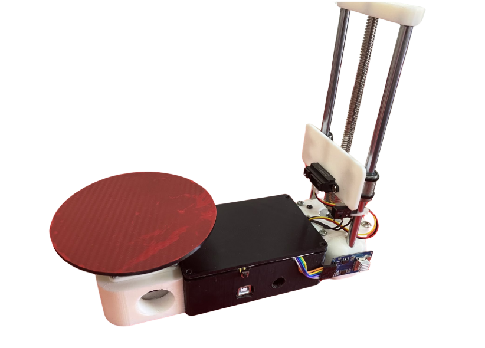

# 3D Scanner

An infrared point cloud scanner using a Sharp distance sensor, stepper motors, and an ATmega328P. Captured coordinates are saved to an SD card for visualization and shape classification.

## Code

| Folder | Contents |
| --- | --- |
| [firmware/avr](firmware/avr) | Bare-metal C firmware and SD adapter |
| [firmware/arduino/3d_scanner](firmware/arduino/3d_scanner) | Arduino sketch |
| [vendor/fatfs](vendor/fatfs) | Bundled FatFs library |
| [docs](docs) | Hardware notes, diagrams, and project report |

Open `firmware/arduino/3d_scanner/3d_scanner.ino` in Arduino IDE for the sketch. The AVR build runs from the repository root with `make`; its SD integration needs completion. See [firmware notes](docs/firmware.md).

[Hardware](docs/hardware.md) · [Report](docs/scanner-report.pdf) · [Shape classifier](https://github.com/lstrjessh/shape-classifier)
